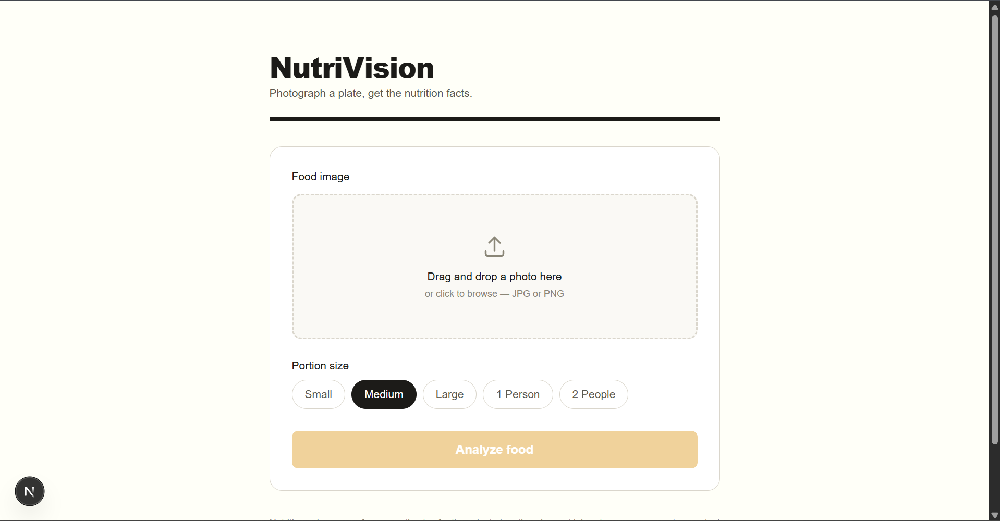
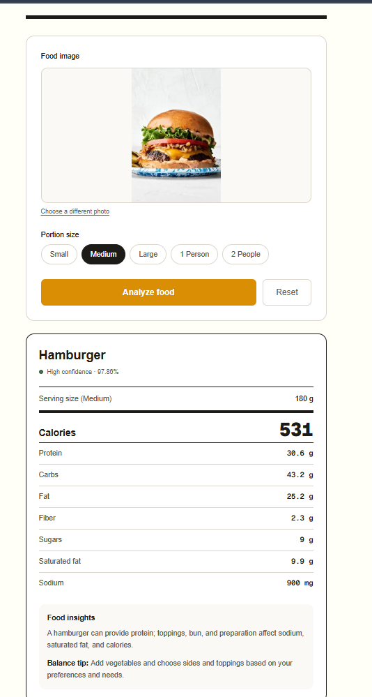
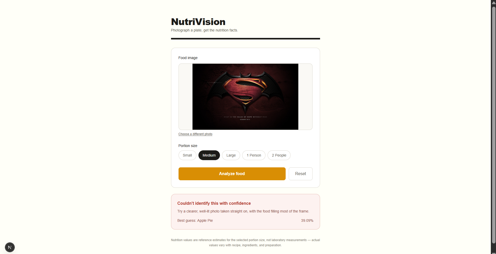

# NutriVision

<!-- Confusion matrix insight

A few interesting patterns:

Apple pie is frequently confused with pancakes, ice cream and cheesecake.
Grilled cheese sandwich has confusion with hamburger and french fries.
Omelette is confused with grilled cheese sandwich and pizza.
Spring rolls have noticeable confusion with samosa.
Pizza is particularly strong, with 243/250 correctly classified.
French fries has 238/250 correctly classified.
Dumplings has 228/250 correctly classified. -->

# NutriVision 🍽️

## AI-Powered Food Image Recognition and Nutritional Analysis using Deep Learning

NutriVision is a lightweight deep learning web application that recognizes food from an uploaded image and provides reference-based nutritional information for a user-selected portion.

The application combines a **MobileNetV2 transfer-learning model**, a **Python/FastAPI inference service**, and a **Next.js frontend**.

> **Important:** NutriVision predicts the food category from the image. Nutrition values are retrieved from a predefined local nutrition database and scaled according to the selected portion. The system does **not** estimate exact calories or portion size directly from image pixels.

---

## ✨ Features

- 📷 Upload and preview a food image
- 🧠 Food classification using MobileNetV2
- 🔬 CNN-based feature extraction
- 🔄 Transfer learning and fine-tuning
- 🍴 15 supported food categories
- ⚖️ Small, Medium, Large, 1 Person, and 2 Persons portions
- 📊 Calories, protein, carbohydrates, and fat calculation
- ⚠️ Low-confidence prediction warning
- ⚡ Lightweight local inference using FastAPI
- 💻 Next.js + TypeScript frontend

---

## 🖼️ Application Screenshots

### Upload a food image

Choose a JPG or PNG image, select a portion size, and analyze it.

<p align="center">
  
</p>

### Example predictions

The hamburger image is classified correctly with **97.86% confidence**. The wallpaper is not a supported food category, but the closed-set classifier still returns its best guess, **Apple Pie**, at **39.09% confidence** and displays a low-confidence warning.

<p align="center">
  
  &nbsp;
  
</p>

---

## 🏗️ System Architecture

```text
User
  │
  ▼
Upload Food Image
  │
  ▼
Next.js Frontend
localhost:3000
  │
  │ HTTP POST /predict
  ▼
FastAPI ML Service
localhost:8000
  │
  ▼
Image Preprocessing
224 × 224 + MobileNetV2 preprocessing
  │
  ▼
MobileNetV2
  │
  ▼
Food Classification
  │
  ├── Food Class
  └── Confidence
  │
  ▼
Nutrition CSV + Portion CSV
  │
  ▼
Portion-based Calculation
  │
  ▼
Calories / Protein / Carbs / Fat
  │
  ▼
Next.js UI
```

---

## 🧠 Deep Learning Concepts

This project demonstrates four main deep learning concepts:

### 1. Convolutional Neural Networks (CNN)

CNNs are designed for image data. They learn visual patterns such as edges, textures, shapes, and higher-level features.

### 2. Convolution and Feature Extraction

Convolutional filters scan the image and learn useful visual representations. In NutriVision, MobileNetV2 performs the main feature extraction.

### 3. Pooling

Pooling reduces spatial information while retaining important features.

NutriVision uses **Global Average Pooling** after the MobileNetV2 feature extractor.

### 4. Transfer Learning

Instead of training a large CNN completely from scratch, NutriVision starts with **MobileNetV2 pretrained on ImageNet**.

The training process has two stages:

1. Train the new classification head while the MobileNetV2 backbone is frozen.
2. Fine-tune selected deeper layers using a smaller learning rate.

---

## 🍕 Supported Food Classes

NutriVision currently supports 15 Food-101 categories:

```text
apple_pie
cheesecake
chicken_curry
chicken_wings
dumplings
french_fries
fried_rice
grilled_cheese_sandwich
hamburger
ice_cream
omelette
pancakes
pizza
samosa
spring_rolls
```

> The current model does not distinguish fine-grained subcategories such as Margherita pizza vs. chicken pizza.

---

## 📊 Dataset

The project uses the **Food-101** dataset as the source dataset.

Food-101 contains:

- 101 food categories
- 101,000 images

For this project, a subset of 15 classes was prepared.

### Dataset Used

| Split | Images/Class | Classes | Total |
|---|---:|---:|---:|
| Training | 600 | 15 | 9,000 |
| Validation | 150 | 15 | 2,250 |
| Testing | 250 | 15 | 3,750 |
| **Total** | | | **15,000** |

---

## ⚙️ Data Preprocessing

Images are:

- Resized to `224 × 224`
- Converted into model-compatible tensors
- Preprocessed using MobileNetV2 preprocessing

Training augmentation:

```text
Random Horizontal Flip
Random Rotation (0.1)
Random Zoom (0.1)
```

Batch size:

```text
32
```

---

## 🏛️ Model Architecture

```text
Input Image
224 × 224 × 3
       │
       ▼
MobileNetV2
ImageNet Weights
       │
       ▼
Global Average Pooling
       │
       ▼
Dense Layer
128 neurons
ReLU
       │
       ▼
Dropout
0.3
       │
       ▼
Dense Layer
15 neurons
Softmax
       │
       ▼
Predicted Food Class
```

### Model Parameters

| Parameter | Value |
|---|---:|
| Total Parameters | 2,423,887 |
| Trainable Parameters | 165,903 |
| Non-trainable Parameters | 2,257,984 |
| Input Size | 224 × 224 × 3 |
| Output Classes | 15 |

---

## 🏋️ Training

### Stage 1: Classification Head

- MobileNetV2 backbone frozen
- Adam optimizer
- Learning rate: `0.001`
- Maximum epochs: `10`
- Best validation accuracy: **77.38%**

### Stage 2: Fine-Tuning

- Fine-tuning starts after layer 100
- Batch Normalization layers kept frozen
- Adam optimizer
- Learning rate: `0.00001`
- Best validation accuracy: **80.93%**
- Best validation loss: **0.6317**

---

## 📈 Final Model Performance

The test set was kept separate and used only for final evaluation.

| Metric | Result |
|---|---:|
| **Test Accuracy** | **84.08%** |
| Test Loss | 0.5189 |
| Macro Precision | 84.08% |
| Macro Recall | 84.08% |
| **Macro F1-score** | **83.88%** |
| Weighted F1-score | 83.88% |

### Best Performing Classes

| Class | F1-score |
|---|---:|
| Dumplings | 93.06% |
| French Fries | 92.61% |
| Pizza | 91.18% |
| Fried Rice | 90.39% |
| Chicken Wings | 89.92% |

### More Challenging Classes

| Class | F1-score |
|---|---:|
| Apple Pie | 65.37% |
| Omelette | 74.68% |
| Grilled Cheese Sandwich | 75.80% |

Some notable visual confusions occurred between:

- Apple pie ↔ pancakes / ice cream / cheesecake
- Grilled cheese sandwich ↔ hamburger / french fries
- Omelette ↔ grilled cheese sandwich / pizza
- Spring rolls ↔ samosa

---

## 🍎 Nutrition Calculation

Nutrition values are stored in:

```text
nutrition/nutrition.csv
nutrition/portion.csv
```

The nutrition database uses a **per 100 g** baseline.

The calculation is:

```text
Nutrition for portion
=
Nutrition per 100 g × Portion weight / 100
```

### Example

For hamburger:

```text
Calories = 295 kcal / 100 g
Medium portion = 180 g
```

Therefore:

```text
295 × 180 / 100 = 531 kcal
```

The same formula is used for:

- Protein
- Carbohydrates
- Fat
- Fiber
- Sugars
- Saturated fat
- Sodium

All nutrition columns in `nutrition.csv` are reference values per 100 g.
The API scales each value to the selected portion; sodium is reported in mg
and all `_g` values are reported in grams.
The same file contains a general food note and balance tip for each supported
class. These are informational, not personalized medical or dietary advice.

> Nutrition values and portion weights are reference/demo estimates. Actual values vary depending on ingredients, recipes, cooking methods, and serving size.

---

## 🔌 Backend API

The ML service is implemented using **FastAPI**.

### Health Check

```http
GET /
GET /health
```

### Prediction

```http
POST /predict
```

The endpoint accepts:

- Food image
- Portion selection

Example response:

```json
{
  "food": "hamburger",
  "confidence": 0.9987,
  "low_confidence": false,
  "portion": "medium",
  "weight_g": 180,
  "insights": {
    "food_note": "A hamburger can provide protein; toppings, bun, and preparation affect sodium, saturated fat, and calories.",
    "balance_tip": "Add vegetables and choose sides and toppings based on your preferences and needs."
  },
  "nutrition": {
    "calories": 531,
    "protein_g": 30.6,
    "carbs_g": 43.2,
    "fat_g": 25.2,
    "fiber_g": 2.34,
    "sugars_g": 9.0,
    "saturated_fat_g": 9.9,
    "sodium_mg": 900
  }
}
```

---

## ⚠️ Low-Confidence Handling

NutriVision uses a practical confidence threshold of:

```text
0.60
```

Predictions below this value are flagged as low-confidence.

This is a **user-facing application rule**, not a scientifically calibrated probability threshold.

An important limitation is that the classifier is a **closed-set classifier**.

For example, if a completely unrelated image is uploaded, the model may still select one of the 15 known classes. A low-confidence warning helps communicate uncertainty.

---

## 💻 Frontend

The frontend is built with:

- Next.js
- TypeScript
- Tailwind CSS

The application provides:

1. Image upload
2. Image preview
3. Portion selection
4. Prediction request
5. Food classification result
6. Confidence score
7. Nutrition information
8. Low-confidence warning
9. Error and loading states

---

## 📁 Project Structure

```text
NutriVision/
│
├── frontend/
│   ├── src/
│   ├── public/
│   └── package.json
│
├── ml-service/
│   ├── main.py
│   ├── check_nutrition.py
│   ├── evaluate_model.py
│   ├── preprocess.py
│   ├── prepare_dataset.py
│   ├── check_dataset.py
│   └── requirements.txt
│
├── dataset/
│   ├── train/
│   ├── validation/
│   └── test/
│
├── models/
│   ├── nutrivision_head.keras
│   ├── nutrivision_finetuned.keras
│   └── class_names.json
│
├── nutrition/
│   ├── nutrition.csv
│   └── portion.csv
│
├── images/
│   ├── image1.png
│   ├── image2.png
│   └── image3.png
│
├── notebooks/
│
├── README.md
└── .gitignore
```

---

## 🚀 Local Setup

### 1. Clone the repository

```bash
git clone <YOUR_REPOSITORY_URL>
cd NutriVision
```

### 2. Frontend

```bash
cd frontend
npm install
npm run dev
```

Frontend:

```text
http://localhost:3000
```

### 3. ML Service

Open another terminal:

```bash
cd ml-service
python -m venv .venv
```

Activate on Windows:

```powershell
.venv\Scripts\activate
```

Install dependencies:

```bash
pip install -r requirements.txt
```

Start FastAPI:

```bash
uvicorn main:app --reload --port 8000
```

ML service:

```text
http://localhost:8000
```

---

## 🧪 Testing

The application was tested with:

- Valid food images
- Different portion sizes
- Invalid file types
- Invalid portion values
- Low-confidence images
- Non-food/unrelated images

Example:

A hamburger image was classified as:

```text
hamburger
confidence: 99.87%
```

A non-food wallpaper image produced an uncertain class prediction, demonstrating the limitation of closed-set classification.

---

## 🔒 Dataset and GitHub

**Do not blindly push the entire `dataset/` folder to GitHub.**

The prepared dataset contains **15,000 image files**, and the original Food-101 dataset is much larger. GitHub is a code repository, not your personal hard drive with delusions of cloud storage.

### Recommended approach

Keep the dataset locally:

```text
dataset/
```

but add it to `.gitignore`:

```gitignore
# Dataset
dataset/
```

Do not commit:

```text
dataset/train/
dataset/validation/
dataset/test/
```

Instead, explain in the README that the dataset is based on Food-101 and provide instructions for obtaining it.

### Also avoid committing

```gitignore
# Python virtual environment
ml-service/.venv/

# Python cache
__pycache__/
*.pyc

# Next.js
frontend/.next/
frontend/node_modules/

# Environment variables / secrets
.env
.env.*
!.env.example

# OS files
.DS_Store
Thumbs.db
```

### Model files

Your trained `.keras` files are also relatively large. For a normal college GitHub repository, you have three reasonable choices:

**Option 1: Keep model files outside GitHub**

Best for a clean repository.

```text
models/
```

Add:

```gitignore
models/*.keras
```

Then document where the trained model should be placed.

**Option 2: Use Git LFS**

Useful if you want the trained model weights versioned with the repository.

**Option 3: Release/model hosting**

For a more complete project, store model weights in a release or model-hosting service and download them during setup.

For your college project, **Option 1 or Git LFS is preferable to stuffing large binaries into ordinary Git history.**

---

## 📌 Recommended `.gitignore`

```gitignore
# =========================
# Dataset
# =========================
dataset/

# =========================
# Python
# =========================
ml-service/.venv/
__pycache__/
*.pyc
*.pyo
*.pyd

# =========================
# TensorFlow / ML
# =========================
models/*.keras
*.h5
*.ckpt
checkpoints/

# =========================
# Next.js
# =========================
frontend/node_modules/
frontend/.next/
frontend/out/

# =========================
# Environment variables
# =========================
.env
.env.*
!.env.example

# =========================
# Logs
# =========================
*.log

# =========================
# OS / IDE
# =========================
.DS_Store
Thumbs.db
.vscode/
.idea/
```

If you decide to commit the trained model through Git LFS, remove:

```gitignore
models/*.keras
```

and track the files using Git LFS.

---

## 📜 Dataset Attribution

This project uses the Food-101 dataset as the source dataset.

**Food-101:**

Bossard, L., Guillaumin, M., & Van Gool, L. (2014). *Food-101 – Mining Discriminative Components with Random Forests*. European Conference on Computer Vision (ECCV).

The repository should clearly acknowledge the dataset and follow the dataset's applicable terms and attribution requirements.

---

## 🚫 Current Limitations

- Only 15 food classes are supported.
- Unsupported images may still be assigned to a known class.
- The system does not detect portion size from the image.
- Nutrition is not calculated from image pixels.
- Nutrition values are reference estimates.
- No object detection or segmentation.
- No medical or personalized nutritional diagnosis.
- No cloud deployment in the current version.

---

## 🔮 Future Scope

- Expand food categories.
- Add unknown/non-food detection.
- Introduce confidence calibration and out-of-distribution detection.
- Add object detection and segmentation.
- Estimate portion size from images.
- Improve and standardize nutrition data.
- Add more detailed food subcategories.
- Optimize the model for mobile/edge devices.
- Deploy the system to the cloud.

---

## 🏆 Final Result

NutriVision successfully combines:

```text
Deep Learning
      +
Computer Vision
      +
Transfer Learning
      +
FastAPI
      +
Next.js
      +
Nutrition Data
```

The final MobileNetV2-based classifier achieved:

**84.08% test accuracy**

and

**83.88% macro F1-score**

on the held-out 15-class test set.

The project demonstrates a complete pipeline from **dataset preparation → preprocessing → model training → fine-tuning → evaluation → API inference → frontend integration → nutrition calculation**.

---

## 📚 References

1. Bossard, L., Guillaumin, M., & Van Gool, L. (2014). *Food-101 – Mining Discriminative Components with Random Forests*. ECCV.
2. Sandler, M., Howard, A., Zhu, M., Zhmoginov, A., & Chen, L.-C. (2018). *MobileNetV2: Inverted Residuals and Linear Bottlenecks*. CVPR.
3. TensorFlow / Keras documentation.
4. FastAPI documentation.
5. Next.js documentation.
